<p align="center">
  <picture>
    <source media="(prefers-color-scheme: dark)" srcset="docs/banner-dark.png">
    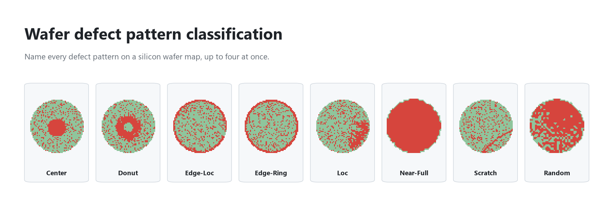
  </picture>
</p>

<p align="center">
  
  
  
  <a href="https://www.kaggle.com/datasets/co1d7era/mixedtype-wafer-defect-datasets"></a>
  <a href="LICENSE"></a>
</p>

A random forest that looks at a 52 × 52 wafer map and names every defect pattern on it. A wafer can carry up to
four defects at once, so the model answers 8 yes/no questions per wafer, one per basic pattern (multi-label
classification). Trained and tested on [MixedWM38](#dataset): 38,015 maps in 38 types.

<p align="center">
  <picture>
    <source media="(prefers-color-scheme: dark)" srcset="docs/scenes/11-dark.gif">
    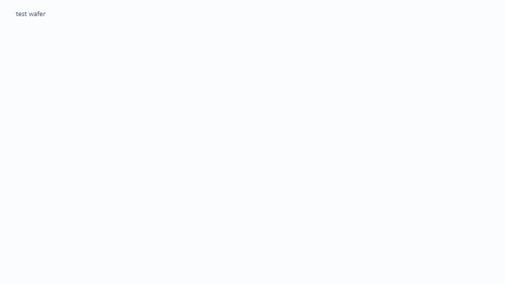
  </picture>
  <br>
  <sub>One test wafer through the forest: the 14 numbers it becomes, the questions the first tree asks, and how all 300 trees vote.</sub>
</p>

## Results

On 5,535 test wafers that were never used for training or for choosing settings:

| | Random forest | Logistic regression baseline |
|---|:---:|:---:|
| **All 8 answers right** on a wafer | **68.3%** | 31.2% |
| Lowest recall of the 8 patterns | **71.1%** (Random) | 0% (Edge-Loc) |
| Training time | 2.2 s | |
| One wafer, features included | 8.6 ms | |

<picture>
  <source media="(prefers-color-scheme: dark)" srcset="docs/results-dark.png">
  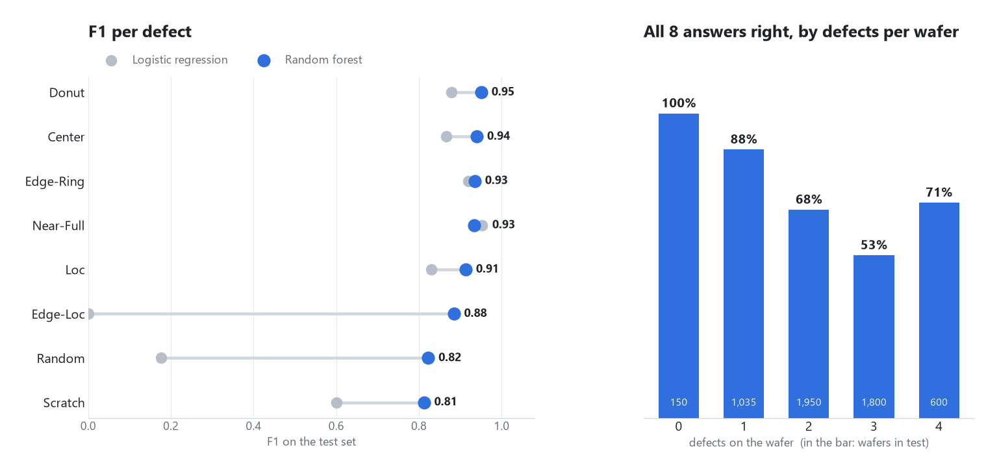
</picture>

**Where it falls short.** 21 of 23 checks in [`08_validate`](pipeline/08_validate.ipynb) pass. On Near-Full the
baseline is slightly better (F1 0.95 against 0.93, only 21 test wafers). And on wafers drawn by rules instead of
taken from the dataset, recall drops sharply for Scratch and Loc: the 14 features say *where* failed dies are, not
what *shape* they form, so a thin line and a small blob in the same slice look alike.

## How it works

| | Step | |
|---|---|---|
| 1 | **Clean** | 105 maps with an undocumented value 3 and every exact copy go out before the split, so no wafer is in both train and test. 38,015 → 36,890. |
| 2 | **Split** | 70 / 15 / 15 per type, so all 38 types are in every part. Seed 42. |
| 3 | **Features** | Each map becomes 14 numbers: the share of failed dies overall, in 5 rings from centre to edge, and in 8 slices around the centre. |
| 4 | **Baseline** | Logistic regression on the same 14 numbers, so the forest has something honest to beat. |
| 5 | **Train** | Six forest settings compared on validation; kept: 300 trees, `max_depth=20`. |
| 6 | **Evaluate** | The test set is opened once, for the scores, the ranking and the mix-ups. |
| 7 | **Stress test** | A rule-based generator draws 50 new wafers for each of the 38 types. |
| 8 | **Validate** | Every requirement checked and written to [`validation.csv`](pipeline/output/validation.csv) as Pass or Fail. |

## The pipeline, animated

[`visualiser/visualiser.html`](visualiser/visualiser.html) plays the pipeline on real wafers in 12 scenes, from the
raw file to the score, with the notebook line behind each step. Open it in a browser; it works offline.

<table>
<tr>
<td width="50%"><picture><source media="(prefers-color-scheme: dark)" srcset="docs/scenes/02-dark.gif">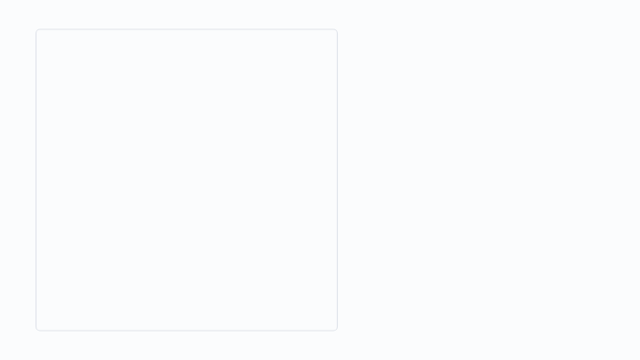</picture><br><sub><b>2</b> · One wafer is a grid of 52 × 52 numbers</sub></td>
<td width="50%"><picture><source media="(prefers-color-scheme: dark)" srcset="docs/scenes/04-dark.gif"></picture><br><sub><b>4</b> · 38 combinations = 38 types</sub></td>
</tr>
<tr>
<td><picture><source media="(prefers-color-scheme: dark)" srcset="docs/scenes/09-dark.gif">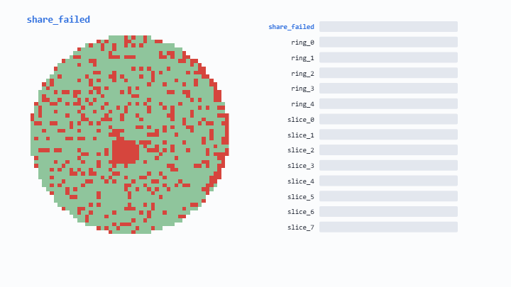</picture><br><sub><b>9</b> · Features: a picture becomes 14 numbers</sub></td>
<td><picture><source media="(prefers-color-scheme: dark)" srcset="docs/scenes/10-dark.gif">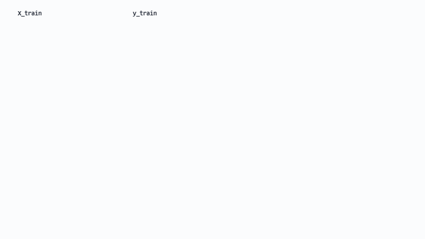</picture><br><sub><b>10</b> · Training: rows in, 300 trees out</sub></td>
</tr>
</table>

<details>
<summary><b>All 12 scenes</b></summary>
<br>
<table>
<tr>
<td width="50%"><picture><source media="(prefers-color-scheme: dark)" srcset="docs/scenes/01-dark.gif"></picture><br><sub><b>1</b> · The raw file</sub></td>
<td width="50%"><picture><source media="(prefers-color-scheme: dark)" srcset="docs/scenes/03-dark.gif"></picture><br><sub><b>3</b> · The label: 8 yes/no answers</sub></td>
</tr>
<tr>
<td><picture><source media="(prefers-color-scheme: dark)" srcset="docs/scenes/05-dark.gif">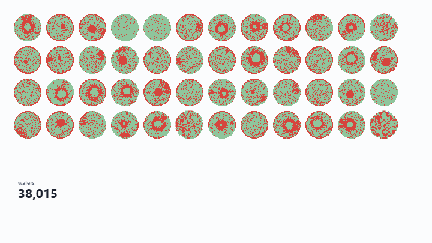</picture><br><sub><b>5</b> · Cleaning: wafers with a value 3</sub></td>
<td><picture><source media="(prefers-color-scheme: dark)" srcset="docs/scenes/06-dark.gif">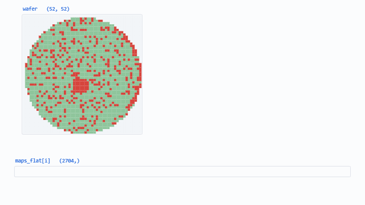</picture><br><sub><b>6</b> · Flattening: 52 rows laid end to end</sub></td>
</tr>
<tr>
<td><picture><source media="(prefers-color-scheme: dark)" srcset="docs/scenes/07-dark.gif">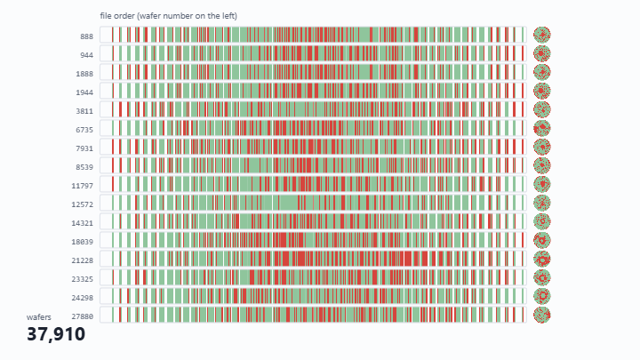</picture><br><sub><b>7</b> · Cleaning: copies</sub></td>
<td><picture><source media="(prefers-color-scheme: dark)" srcset="docs/scenes/08-dark.gif">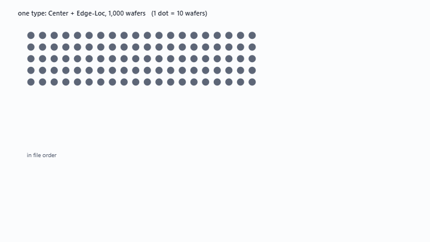</picture><br><sub><b>8</b> · The split: 70 / 15 / 15 per type</sub></td>
</tr>
<tr>
<td><picture><source media="(prefers-color-scheme: dark)" srcset="docs/scenes/11-dark.gif"></picture><br><sub><b>11</b> · One test wafer through the forest</sub></td>
<td><picture><source media="(prefers-color-scheme: dark)" srcset="docs/scenes/12-dark.gif">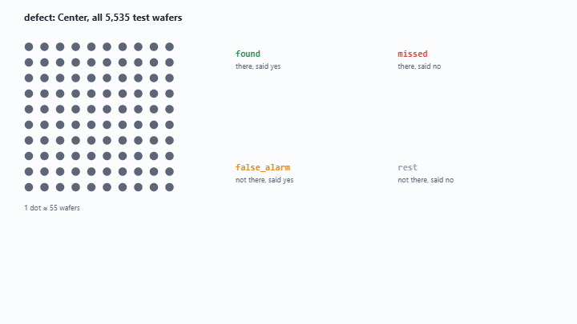</picture><br><sub><b>12</b> · Scoring: found, missed, false alarm</sub></td>
</tr>
</table>
</details>

## Run it

```bash
pip install -r requirements.txt
```

1. Download `Wafer_Map_Datasets.npz` (412 MB) from
   [Kaggle](https://www.kaggle.com/datasets/co1d7era/mixedtype-wafer-defect-datasets) into `data/`.
2. From inside `pipeline/` (or `pipeline_simple/`), run all nine notebooks in order, each in a fresh kernel:

   ```bash
   python run_all.py
   ```

Seed 42 is used everywhere, so a rerun gives the same numbers; only the timings move. The notebooks are saved with
their outputs, so you can also just read them here. Afterwards, `python build.py` in `visualiser/` and
`python make_figures.py` in `docs/` redraw the animation and the charts from your run.

## What's in here

| | |
|---|---|
| [`pipeline/`](pipeline) | The full version: nine notebooks, each step explained, with hand-written scoring in `wafer.py`. Results in `output/`. |
| [`pipeline_simple/`](pipeline_simple) | The same project, shorter, using scikit-learn's own metrics. The best place to start reading. |
| [`visualiser/`](visualiser) | The animated walkthrough, and the script that fills it with data. |
| [`docs/`](docs) | The pictures on this page. |

`01` explore · `02` clean and split · `03` features · `04` baseline · `05` train · `06` evaluate and rank ·
`07` generator · `08` validate · `09` demo

## Dataset

**MixedWM38**, from [Mixed-type Wafer Defect Datasets](https://www.kaggle.com/datasets/co1d7era/mixedtype-wafer-defect-datasets)
on Kaggle. 38,015 wafer maps of 52 × 52, where 0 is no die, 1 a die that passed and 2 a die that failed; 1 normal
type, 8 single-defect types and 29 mixed types. Part of the maps were generated by the authors to balance the
classes. The dataset is not included in this repository. All credit for it goes to its authors; the official
repository is [Junliangwangdhu/WaferMap](https://github.com/Junliangwangdhu/WaferMap).

> Wang, J., Xu, C., Yang, Z., Zhang, J., & Li, X. (2020). Deformable convolutional networks for efficient
> mixed-type wafer defect pattern recognition. *IEEE Transactions on Semiconductor Manufacturing, 33*(4), 587–596.
> https://doi.org/10.1109/TSM.2020.3020985

## License

The code is [MIT](LICENSE). The dataset keeps the terms of its authors.
